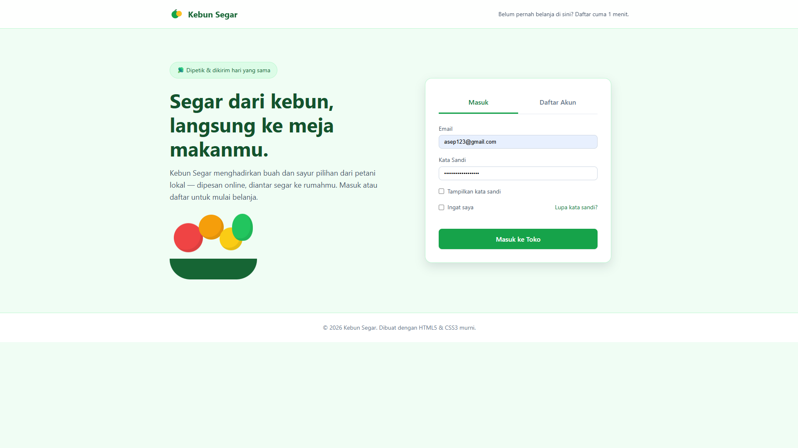
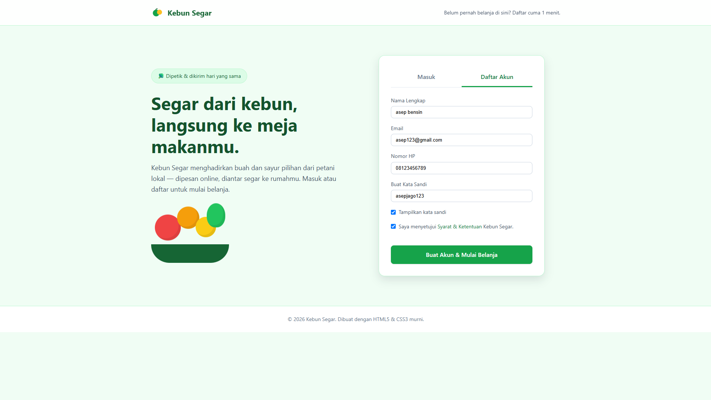
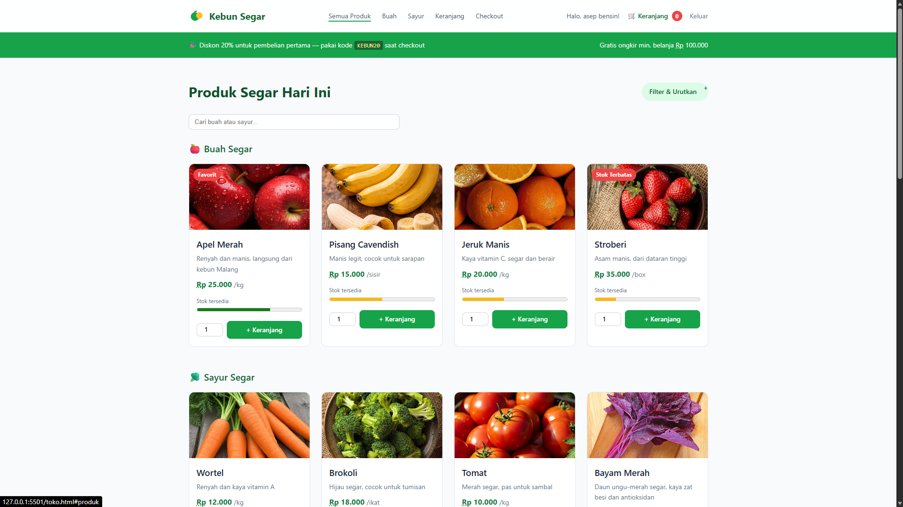
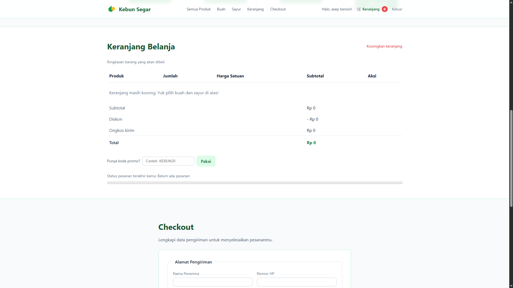

# 🥦 Kebun Segar — Toko Buah & Sayur Online

Website toko buah dan sayur segar dengan dua halaman: **halaman login/daftar** dan **halaman toko** (produk, keranjang, checkout). Dibuat sebagai tugas penerapan **HTML, CSS, JavaScript, dan API**.

| | |
|---|---|
| **Nama** | Hamzah Alwi Ramadhani |
| **NIM** | 202410370110026 |
| **Tugas** | Penerapan HTML, CSS, JavaScript, dan API |

---

## 📌 Deskripsi

Kebun Segar adalah toko buah dan sayur online bernuansa cerah dan segar. Pengguna masuk (atau mendaftar) lebih dulu, lalu belanja di halaman toko: mencari produk, memasukkan ke keranjang, memakai kode promo, dan checkout dengan alamat pengiriman yang datanya diambil dari API.

## ✅ Penerapan Materi

| Materi | Penerapan di project | File |
|---|---|---|
| **HTML** | Struktur semantik: `header`, `nav`, `main`, `section`, `article`, `aside`, `footer`, `table`, `form`, `fieldset`, `details`, `meter`, `progress`, dll. | `login.html`, `toko.html` |
| **CSS** | Gaya utility class ala Tailwind (ditulis manual, tanpa framework), CSS variables warna, Flexbox, Grid, `@media` responsif, animasi `@keyframes`, tab login murni CSS | `style.css` |
| **JavaScript** | Validasi form, login demo dengan `localStorage`, keranjang dinamis, kode promo, cari/filter/urutkan produk, checkout, notifikasi | `login.js`, `toko.js` |
| **API** | `fetch` + `async/await` ke API Wilayah Indonesia untuk dropdown Provinsi → Kota/Kabupaten → Kecamatan | `api.js` |

## ✨ Fitur

**Halaman Login (`login.html`)**
- Tab **Masuk** dan **Daftar Akun** (berpindah tanpa JavaScript, memakai CSS)
- Validasi input (email, kata sandi minimal 8 karakter, nomor HP 10–14 digit)
- Checkbox "Tampilkan kata sandi"
- Data pengguna disimpan di `localStorage`, lalu otomatis pindah ke halaman toko

**Halaman Toko (`toko.html`)**
- Sapaan nama pengguna dan jumlah barang di keranjang (badge)
- 8 produk (4 buah + 4 sayur) lengkap dengan foto, harga, dan indikator stok
- **Cari produk** dan **filter & urutkan** (kategori, harga termurah/termahal, nama A–Z)
- **Keranjang dinamis**: tambah, kurangi, hapus, kosongkan; data tetap ada walau halaman di-refresh
- Ringkasan otomatis: subtotal, diskon, ongkos kirim, total
- **Kode promo** `KEBUN20` (diskon 20%)
- **Checkout** dengan alamat dari API: Provinsi → Kota/Kabupaten → Kecamatan
- **Ongkir otomatis** menyesuaikan provinsi (Jawa Timur Rp 10.000, lainnya Rp 25.000, gratis jika belanja minimal Rp 100.000)
- Notifikasi (toast) saat produk masuk keranjang

## 🌐 API yang Digunakan

**API Statis Wilayah Indonesia** oleh emsifa — gratis, tanpa API key.
Dokumentasi: <https://www.emsifa.com/api-wilayah-indonesia/>

| Endpoint | Fungsi |
|---|---|
| `GET /v2/provinces.json` | Daftar provinsi |
| `GET /v2/regencies/{kodeProvinsi}.json` | Daftar kota/kabupaten dalam provinsi |
| `GET /v2/districts/{kodeKota}.json` | Daftar kecamatan dalam kota/kabupaten |

Jika koneksi ke API gagal, halaman tidak rusak: muncul pesan error dan alamat lengkap tetap bisa diisi manual.

## 🛠️ Teknologi

- HTML5
- CSS3 (utility class ala Tailwind, ditulis manual)
- JavaScript (vanilla, tanpa framework)
- Fetch API + `localStorage`

## 📁 Struktur Folder

```
kebun-segar/
├── login.html          # Halaman 1: login / daftar
├── toko.html           # Halaman 2: toko, keranjang, checkout
├── style.css           # Seluruh styling
├── login.js            # Logika halaman login
├── toko.js             # Logika toko: keranjang, promo, filter, checkout
├── api.js              # Pemanggilan API wilayah (fetch)
├── images/             # Foto produk (apel, pisang, jeruk, stroberi, wortel, brokoli, tomat, bayam)
├── screenshots/        # Dokumentasi tampilan website
└── README.md
```

## ▶️ Cara Menjalankan

1. Ekstrak/unduh project, lalu buka foldernya di **VS Code**.
2. Install extension **Live Server**.
3. Klik kanan `login.html` → **Open with Live Server**.
4. Pastikan **terhubung ke internet** (data wilayah diambil dari API).

> Selalu mulai dari `login.html`. Halaman toko meminta login terlebih dahulu.

## 🧪 Cara Mencoba

1. Di halaman login, isi email dan kata sandi (minimal 8 karakter), lalu klik **Masuk ke Toko**.
2. Di halaman toko, klik **+ Keranjang** pada beberapa produk.
3. Buka bagian **Keranjang**, ubah jumlah barang, lalu coba kode promo `KEBUN20`.
4. Di bagian **Checkout**, pilih Provinsi → Kota/Kabupaten → Kecamatan dan lihat ongkir berubah.
5. Isi alamat lengkap, lalu klik **Checkout Sekarang**.

## 📸 Dokumentasi Tampilan

### 1. Halaman Login — Tab Masuk
Form masuk dengan opsi "Tampilkan kata sandi" dan "Ingat saya".



### 2. Halaman Login — Tab Daftar Akun
Form pendaftaran (nama, email, nomor HP, kata sandi) dengan persetujuan syarat & ketentuan.


### 3. Halaman Toko — Daftar Produk
Sapaan pengguna, badge keranjang, banner promo, kotak pencarian, dan produk buah serta sayur lengkap dengan foto, harga, dan stok.



### 4. Keranjang Belanja
Tabel keranjang dinamis dengan ringkasan subtotal, diskon, ongkos kirim, total, kolom kode promo, dan status pesanan.



### 5. Checkout dengan API Wilayah
Dropdown Provinsi, Kota/Kabupaten, dan Kecamatan terisi dari API. Pada contoh ini dipilih Jawa Barat → Kabupaten Bandung → Bojongsoang, dan ongkir otomatis menjadi Rp 25.000.



## 📝 Catatan

- Login bersifat **demo**: kata sandi tidak diperiksa ke server. Data hanya disimpan di `localStorage` browser.
- Tombol "Checkout Sekarang" menampilkan pesan sukses dan mengosongkan keranjang; belum terhubung ke sistem pembayaran sungguhan.
- Foto produk hanya digunakan untuk keperluan tugas/pembelajaran.

## 🙏 Kredit

- Data wilayah: [API Statis Wilayah Indonesia](https://www.emsifa.com/api-wilayah-indonesia/) oleh emsifa.
